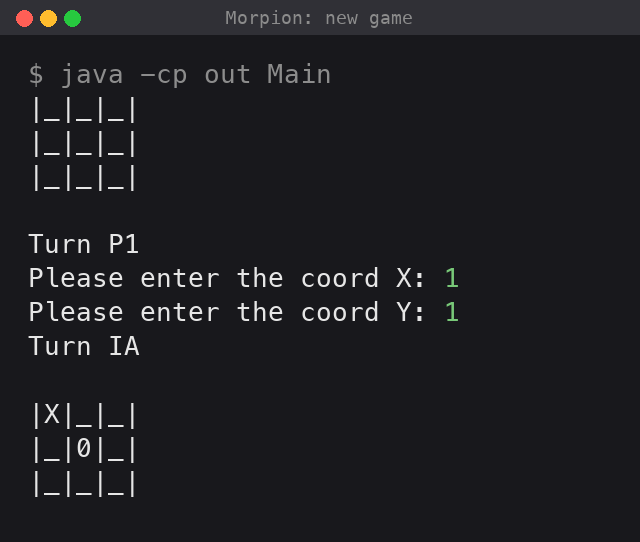
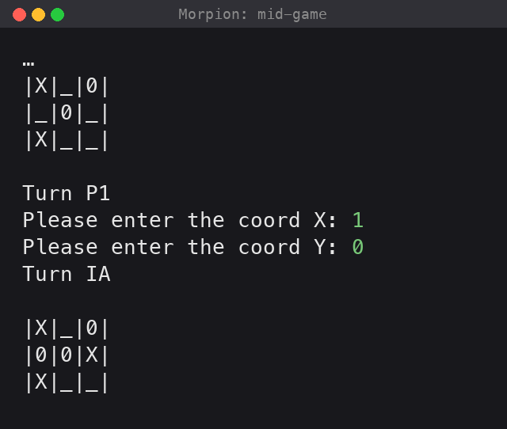
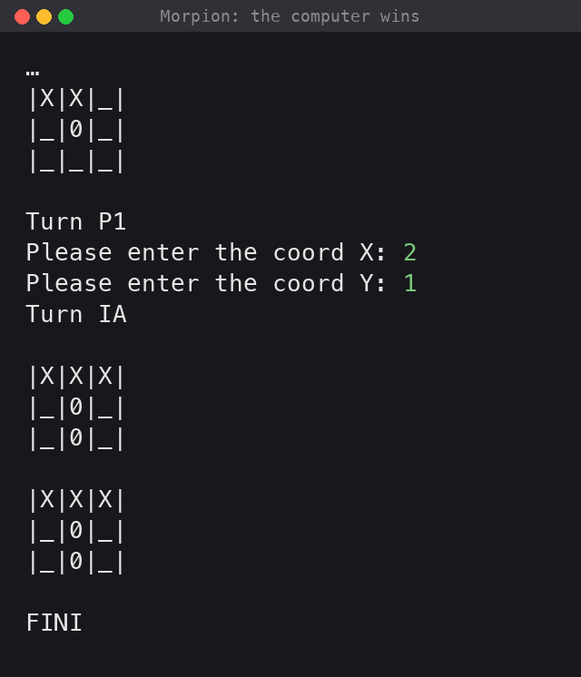
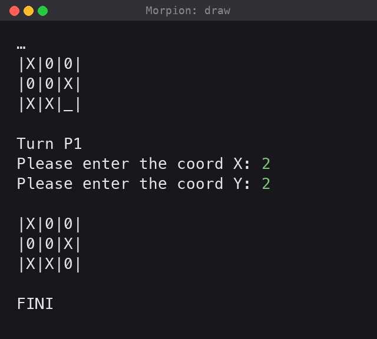

# Morpion (Tic-Tac-Toe)

[](https://github.com/LaCobble/Morpion/actions/workflows/ci.yml)
[](LICENSE)


A console Tic-Tac-Toe ("morpion" in French) in Java, where the computer picks its moves with the **Minimax** algorithm.

## What it does

- Displays a 3 x 3 board in the terminal.
- You play `0`: enter the row (`X`) then the column (`Y`) of your move, each between 0 and 2.
- The computer plays `X` and answers with the best move found by Minimax.
- The game stops when a player aligns three symbols (row, column or diagonal) or the board is full.

## Screenshots

<table>
  <tr>
    <td align="center" valign="top" width="25%"><br><sub>New game</sub></td>
    <td align="center" valign="top" width="25%"><br><sub>Mid-game</sub></td>
    <td align="center" valign="top" width="25%"><br><sub>The computer wins</sub></td>
    <td align="center" valign="top" width="25%"><br><sub>Draw</sub></td>
  </tr>
</table>

*Rendered from the real console output of local runs; the coordinates typed by the player are shown in green after each prompt (the program does not echo them). The player plays 0, the computer X.*

## Requirements

- A JDK (tested with JDK 17).

## Build and run

```bash
git clone https://github.com/LaCobble/Morpion.git
cd Morpion
javac -encoding UTF-8 -d out src/*.java
java -cp out Main
```

## Project structure

```
src/
├── Main.java                  # Game loop: player turn, then computer turn
├── Board.java                 # Board, win detection, player input, Minimax
├── PointsAndScores.java       # A candidate move and its Minimax score
├── ApplicationException.java  # Coordinate out of range
└── IntException.java          # Input is not an integer
```

## What it demonstrates

- The **Minimax** algorithm: a recursive exploration of every possible continuation, scoring wins (+1), losses (-1) and draws (0), to choose the best move for the computer.
- Game-state modelling on a 2D array, with row, column and diagonal win detection.
- Custom checked exceptions for input validation.

## Known limitations

Kept as written for the assignment:

- An invalid input (out-of-range coordinate or non-integer) stops the program with an exception instead of asking again.
- Choosing a cell that is already taken is silently ignored, and the turn passes to the computer.

## Context

School project (2022), algorithms course. The comments and some identifiers are in French.

## Contributing

This is an archived learning project, but issues and pull requests are welcome: see [CONTRIBUTING.md](CONTRIBUTING.md) and the [Code of Conduct](CODE_OF_CONDUCT.md).

## License

[MIT](LICENSE) © LaCobble
